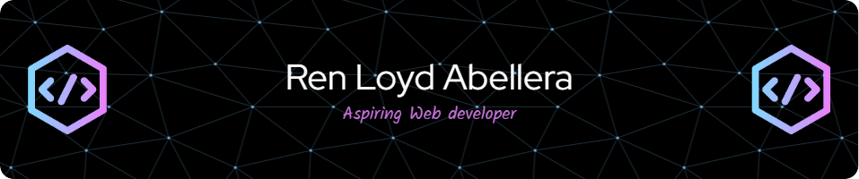

  

  <h1>Hi, I'm Loyd 👋</h1>
  <h3>BSIT graduate · Network & Technical Support · Aspiring Web Developer</h3>
  
📍 Polomolok, South Cotabato, Philippines 🇵🇭

  

---

## 🧑‍💻 About me

I'm a Bachelor of Science in Information Technology graduate with over a year of hands-on experience troubleshooting networks and resolving customer incidents at scale. I enjoy finding the root cause of a problem, and I'm now turning that mindset toward building web apps.

- 🌱 Currently learning **React.js**
- 🔧 Background in **network troubleshooting, incident management and fiber optic repair**
- 🛠️ Building web projects with **HTML, CSS, JavaScript, PHP and MySQL**
- 🤖 Comfortable working with **AI-assisted coding tools**
- 🎬 I also edit videos (Filmora, CapCut) as a side skill

## 🧰 Tech stack

**Web development**

  
  
  
  
  
  
  

**IT & networking**

- **Troubleshooting:** LAN/WAN, TCP/IP, Wi-Fi and wired connectivity, authentication issues, root cause analysis
- **Network platforms:** Fortinet, UniFi, Ruckus, CloudTrax, Nomadix
- **Ticketing:** Zendesk
- **Fiber optics:** splicing and repair, OTDR, optical power meter

## 📊 GitHub stats

  
  

  

## 📫 Connect with me

  
  

